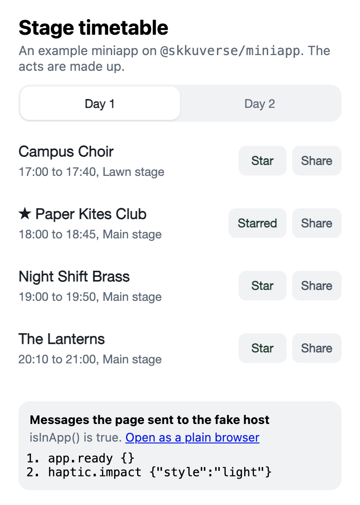

# skkuverse-miniapp &middot; [](https://github.com/spencer0124/skkuverse-miniapp/actions/workflows/ci.yml?query=branch%3Amain) [](https://www.npmjs.com/package/@skkuverse/miniapp) [](./LICENSE)

[Docs](https://spencer0124.github.io/skkuverse-miniapp/) · [llms.txt](https://spencer0124.github.io/skkuverse-miniapp/llms.txt) · [Live demo](https://spencer0124.github.io/skkuverse-miniapp/examples/stage-timetable/)

skkuverse-miniapp is the SDK, the design system and the tools for skkuverse miniapps, the small Vite and React pages that run inside the skkuverse app. Each tool ends in a check that can fail, so a person or an LLM can prove that a change works before it ships.

- `@skkuverse/miniapp` gives a page typed calls to the app, such as `haptic()` and `share()`, over the [bridge protocol](https://spencer0124.github.io/skkuverse-miniapp/docs/reference/protocol). Outside the app, each call does nothing or falls back to the browser.
- `miniapp-cli check` holds a package to every rule the [miniapp spec](https://spencer0124.github.io/skkuverse-miniapp/docs/reference/miniapp-spec) marks `checked`, and names each broken rule by its ID.
- A fake host from `@skkuverse/miniapp/testing` runs the app's real bootstrap script in a test or a browser, as the live demo does.
- Six miniapps built on these packages ran at Sungkyunkwan University's ESKARA 2026 festival, where the festival shuttle alone was used on 1,070 devices in two days ([case study](docs/explanation/case-study-eskara-2026.md)).
- CI compiles every TypeScript example in the docs and fails when a generated count drifts from the code ([what CI checks](docs/explanation/ci-and-branch-protection.md#workflows)).

## Packages

<!-- docs-gen:begin package-table -->

| Package | Description | Version |
| --- | --- | --- |
| [`@skkuverse/miniapp`](packages/miniapp) | The skkuverse miniapp SDK: the web↔app bridge protocol, a typed client for it, and React bindings. | [](https://www.npmjs.com/package/@skkuverse/miniapp) |
| [`@skkuverse/ui`](packages/ui) | SKKU Design System (SDS) for the web: providers and components ported from the skkuverse app. | [](https://www.npmjs.com/package/@skkuverse/ui) |
| [`@skkuverse/tokens`](packages/tokens) | SKKU Design System tokens for the web: colors, typography, spacing and radius, plus CSS adapters. | [](https://www.npmjs.com/package/@skkuverse/tokens) |
| [`@skkuverse/miniapp-cli`](packages/cli) | check, new and ship for a repository of skkuverse miniapps and games. | [](https://www.npmjs.com/package/@skkuverse/miniapp-cli) |
| [`@skkuverse/game-contract`](packages/game-contract) | Plays a built skkuverse game page against the SDK fake host and holds it to the game protocol contract. | [](https://www.npmjs.com/package/@skkuverse/game-contract) |

<!-- docs-gen:end package-table -->

## Installation

```bash
npm install @skkuverse/miniapp @skkuverse/ui
```

## Quick Start

Use `MiniappRoot` and the SDK to build a page that the app frames and that still opens in a plain browser. In this example, a button gives haptic feedback and opens the share sheet.

```tsx
import { createRoot } from 'react-dom/client';
import { haptic, share } from '@skkuverse/miniapp';
import { MiniappRoot } from '@skkuverse/miniapp/react';
import { Button, SDSProvider } from '@skkuverse/ui';

createRoot(document.getElementById('root')!).render(
  <MiniappRoot id="my-app" browser="allow">
    <SDSProvider>
      <Button onClick={() => { haptic('light'); void share({ url: location.href }); }}>Share</Button>
    </SDSProvider>
  </MiniappRoot>,
);
```

The [live demo](https://spencer0124.github.io/skkuverse-miniapp/examples/stage-timetable/) is a page built this way. It runs in a browser against the fake host and lists each message the page sends to the app.

<a href="https://spencer0124.github.io/skkuverse-miniapp/examples/stage-timetable/" target="_blank" rel="noreferrer"></a>

In a repository laid out as the [CLI README](packages/cli/README.md) describes, these steps create a miniapp, check it against the spec and deploy a preview. The second line is an edit to make by hand, not a command.

```sh
pnpm exec miniapp-cli new my-app              # write apps/my-app from the template
# add "my-app": { "project": "miniapp-my-app" } under "apps" in deploy.config.json
pnpm install                                  # link apps/my-app and install its dependencies
pnpm --filter ./apps/my-app build             # write apps/my-app/dist
pnpm exec miniapp-cli check my-app            # check it against the spec
pnpm exec miniapp-cli ship my-app --preview   # build, check and deploy a preview with wrangler
```

[Ship a miniapp](docs/how-to/ship-a-miniapp.md) follows a miniapp from a folder on disk to a screen in the app.

## Check your work

Each command below exits with a non-zero code and names what broke. Run the one that matches your change and read its output, rather than judging the change by eye. [Test a miniapp without the app](docs/how-to/test-without-the-app.md) shows a fake host test in full.

| After you change | Run | It fails when |
| --- | --- | --- |
| A miniapp or a game package | `miniapp-cli check --json` | The package breaks a rule that the [miniapp spec](docs/reference/miniapp-spec.md) marks `checked`. Each finding names its rule ID |
| What a page sends to the app | A test that installs `createFakeHost()` from `@skkuverse/miniapp/testing` | The test's assertions on `host.log` fail. `checkGameContract(host.log)` names each game protocol rule the page broke |
| A built game | `game-contract` | A run breaks the game protocol, with the host there from the start or arriving late |
| This repository | `pnpm check:ci` | A step that CI runs fails: <!-- docs-gen:begin ci-steps -->`install`, `build`, `typecheck`, `test`, `lint`, `lint-md`, `knip` and `owner-gate`<!-- docs-gen:end ci-steps --> |

## AI Integration

- [llms.txt](https://spencer0124.github.io/skkuverse-miniapp/llms.txt) links the Markdown copy of every docs page, and [llms-full.txt](https://spencer0124.github.io/skkuverse-miniapp/llms-full.txt) holds every page in one file.
- `miniapp-cli check --json` prints one JSON array on stdout and exits 1 when a finding is an error. Each finding names its rule ID and the spec section that defines it, as the [CLI README](packages/cli/README.md#read-the-findings-as-json) describes:

  ```json
  [
    {"id":"my-app","kind":"app","rule":"O1","level":"error","message":"no dist/ (run the build first)","spec":"docs/reference/miniapp-spec.md#build-output"}
  ]
  ```

- [CLAUDE.md](CLAUDE.md) gives a coding agent the packages, the commands and the constraints of this repository, such as the entry boundaries that a test enforces.

## In production


Six miniapps built on `@skkuverse/miniapp` ran inside the skkuverse app at ESKARA 2026, Sungkyunkwan University's festival, on 2026-10-01 and 2026-10-02 (KST). The [ESKARA 2026 case study](docs/explanation/case-study-eskara-2026.md) defines each number and lists what the festival changed in the SDK. Over those two days, the app's analytics counted 2,118 devices that used the app, 1,477 that used one of the six miniapps or the map's festival layer, and 1,070 that used the festival shuttle, the most used miniapp.

The miniapps' source lives outside this repository. The live demo is a miniapp of the same shape, and lists every message it sends to the app.

<br clear="right">

## Documentation

- [Architecture](https://spencer0124.github.io/skkuverse-miniapp/docs/explanation/architecture), for how the packages, the app and the server fit
- [Protocol](https://spencer0124.github.io/skkuverse-miniapp/docs/reference/protocol), for the contract with the app
- [Miniapp spec](https://spencer0124.github.io/skkuverse-miniapp/docs/reference/miniapp-spec), for what a miniapp or a game must be before skkuverse hosts it
- [API reference](https://spencer0124.github.io/skkuverse-miniapp/docs/reference/api/README), for every entry point, generated from the source
- [Docs index](https://spencer0124.github.io/skkuverse-miniapp/docs/README), for every how-to, reference, explanation and decision

## Known gaps

- `@skkuverse/ui` and `@skkuverse/tokens` have no tests. CI builds them, type-checks them and runs publint and are-the-types-wrong on them.
- No code linter, such as ESLint, runs on the source. `pnpm lint` is publint and are-the-types-wrong, which check what a package publishes.
- The <!-- docs-gen:begin token-files form=count -->four<!-- docs-gen:end token-files --> token files in `packages/tokens` are copies of skkuverse-app's, and nothing checks that they still match ([why](docs/explanation/ci-and-branch-protection.md#what-ci-does-not-check)).
- `@skkuverse/miniapp-cli` and `@skkuverse/game-contract` depend on `@skkuverse/miniapp` with a caret on a `0.x` version, which never crosses a minor. Each minor release of the SDK therefore needs a release of both.

## Contributing

Issues are welcome. Pull requests are by invitation: read [CONTRIBUTING.md](CONTRIBUTING.md) first. Report a vulnerability privately, as [SECURITY.md](SECURITY.md) describes. Everyone taking part follows the [code of conduct](CODE_OF_CONDUCT.md).

After `pnpm install`, `pnpm check:ci` runs the steps CI runs, in the same order, and stops at the first one that fails. Add a changeset with each change (`pnpm changeset`). The release procedure is in [release-packages.md](docs/how-to/release-packages.md).

## License

Apache-2.0. Copyright 2024-2026 spencer0124. See [LICENSE](./LICENSE) for details.
