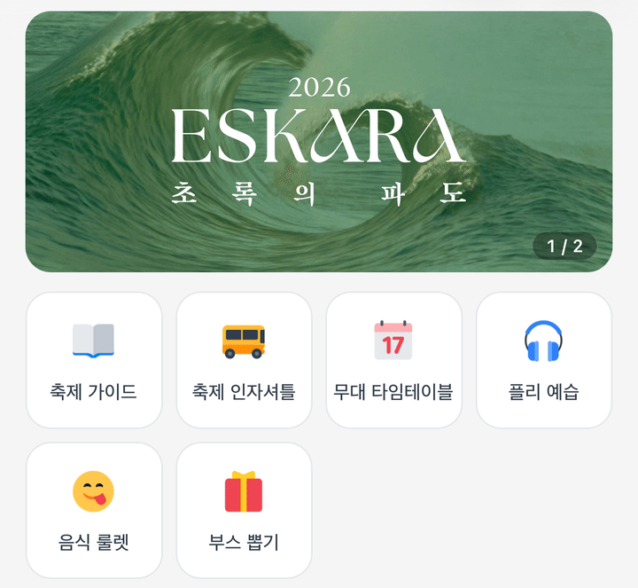

# The SDK at ESKARA 2026

> What ran on these packages at Sungkyunkwan University's festival on 2026-10-01 and 2026-10-02, what was counted, and what running it changed in the library. Read it to judge whether the SDK has carried real traffic, or to learn why some of its parts are shaped the way they are.

## Summary

Six festival miniapps opened inside the skkuverse app during ESKARA 2026, and all six imported `@skkuverse/miniapp`, at version 0.2.1 or 0.3.0. Over the two festival days, 2,118 devices used the app and 1,477 of them used a festival feature. The festival shuttle miniapp was the most used, on 1,070 devices.

The published SDK came out of building for that festival. The miniapps built for it each carried their own copy of the bridge code, the copies drifted apart, and they became one published package six days before the festival. After the festival, the rules the miniapps had followed by habit became a written spec and a CLI that checks it.

The miniapps' source lives outside this repository. This document describes what they used from these packages, not their code.

## The six miniapps

Each miniapp was a Vite and React page that the app opened from a tile on its home screen, wrapped in `MiniappRoot`.

| Miniapp (registry id) | What it did | What it used from these packages |
| --- | --- | --- |
| Festival guide (`eskara-2026`) | The line-up and festival information | `openUrl`, `openMapPlace`, `canOpenMap`, `handleLinkClick`, and `@skkuverse/ui` components |
| Festival shuttle (`inja`) | Shuttle stops, and each departure as a staff member marked it | `ready`, `openMapPlace`, `canOpenMap`, and `@skkuverse/ui` components |
| Stage timetable (`timetable`) | Who plays on which stage, and when | `@skkuverse/ui` components |
| Playlist preview (`playlist`) | Songs to learn before the concerts | `haptic`, `handleLinkClick`, and `@skkuverse/ui` components |
| Food roulette (`mukja`) | Picks something to eat at the festival, at random | `haptic`, `MapButton`, and `@skkuverse/ui` components |
| Booth draw (`booth-box`) | Picks a booth at random and shares it | `useIsInApp`, `useCanOpenMap`, `openMapPlace`, `share`, `canShare`, and `haptic` |

The [stage timetable example](../../examples/stage-timetable) in this repository has the shape of the third row, with made-up acts. It runs in a browser on the fake host and lists each bridge message it sends.

## What was counted

The app's analytics counted these numbers. The unit is a device, not a person. A phone that reinstalls the app counts again, and one person with two phones counts twice. The period is 2026-10-01 to 2026-10-02 in Korea Standard Time, and the counts come from a recount on finished data, made on 2026-11-04.

| Measure | Value |
| --- | --- |
| Devices that used the app on either day | 2,118 |
| Devices active on 2026-10-01, and on 2026-10-02 | 1,343 and 1,533 |
| Devices that used a festival feature, which is one of the six miniapps or the festival layer of the app's map | 1,477 (69.7% of 2,118) |

Per miniapp, over the same two days:

| Miniapp | Devices | Opens |
| --- | --- | --- |
| Festival shuttle (`inja`) | 1,070 | 3,095 |
| Festival guide (`eskara-2026`) | 697 | 2,472 |
| Stage timetable (`timetable`) | 608 | 1,754 |
| Playlist preview (`playlist`) | 324 | 732 |
| Food roulette (`mukja`) | 180 | 238 |
| Booth draw (`booth-box`) | 109 | 124 |

A device that opened two miniapps appears in both rows, so the rows do not add up to a total. The festival's two games are not miniapps and are not in these tables.

## What production taught the library

Each item names the problem, the decision, and the change in this repository. The evidence line says whether the link between the festival and the change is recorded in the change itself, or inferred from the dates.

### Copies drift, so the SDK became one package

While the festival miniapps were being built, each miniapp carried its own copy of the tokens, the UI kit and the bridge code, with a file of helpers beside them. By 2026-09-25 six copies disagreed. Three lacked the `appUrl` option of `openUrl`, and the helpers existed in four different subsets. A fix to one copy reached one miniapp.

The decision was to publish one SDK to npm and make it the source of truth for the bridge protocol, so a miniapp takes a fix by bumping a version. [ADR 0001](../decisions/0001-sdk-distribution.md) records the decision, and commit [`e63cfae`](https://github.com/spencer0124/skkuverse-miniapp/commit/e63cfae41750c9beaccbf7033ef9db254a7c047e) made the three packages. Version 0.1.0 reached npm the same evening, and the festival builds used 0.2.1 or 0.3.0.

Evidence: recorded for the drift, which the commit message describes. That the drifted miniapps were festival work comes from the dates.

### A page shared outside the app sat under the notch

`MiniappRoot` set every `--sv-*` safe-area variable to zero outside the app. A page that allowed browsers, opened in Safari on an iPhone, then put its content under the notch.

The decision was to set the device layer to the browser's own `env(safe-area-inset-*)` outside the app and keep the app's layer at zero. Commit [`037a23b`](https://github.com/spencer0124/skkuverse-miniapp/commit/037a23bbef903f124391f8f1657c19edf5c89db8) made the change, and it shipped as [0.2.1](../../packages/miniapp/CHANGELOG.md#021), the version five of the six miniapps depended on.

Evidence: inferred. The commit describes the Safari problem but does not name a miniapp.

### A miniapp needed to share a link

The booth draw miniapp hands out a random booth, and a draw is worth sending to a friend. The bridge had no way to open the app's share sheet. The decision was a `share()` function that uses the app's sheet in the app, the browser's share sheet outside it, and the clipboard as a last resort, and that returns which one happened so the page can tell the user about a copy. Commit [`f0c4a27`](https://github.com/spencer0124/skkuverse-miniapp/commit/f0c4a277d99081db5ac838532228b051a9ea270f) added it, and it shipped as [0.3.0](../../packages/miniapp/CHANGELOG.md#030) on 2026-09-26. The booth draw was the one miniapp on 0.3.0, and it calls `share` and `canShare`.

Evidence: inferred from the dates and the miniapp's imports. The commit does not name the miniapp.

### Rules kept by habit became a spec and a check

The six miniapps followed the same conventions by habit: the manifest, the host name, the build output and the browser policy. Nothing failed when a miniapp broke one. Three days after the festival, the conventions became the [miniapp spec](../reference/miniapp-spec.md), with an ID for each rule, and `miniapp-cli check` began to enforce the rules marked `checked` ([`95ce19d`](https://github.com/spencer0124/skkuverse-miniapp/commit/95ce19d8d4cb8f0612767867e03f0e7d9ed3e788), [`e5afe21`](https://github.com/spencer0124/skkuverse-miniapp/commit/e5afe217b166800ade1cfd0d78d80bbc193d1b5e)). [ADR 0003](../decisions/0003-spec-checker-in-this-repository.md) later moved the checker into this repository, beside the spec.

The festival is still visible in the spec. Rule R4 puts every miniapp on `<id>.mini.skkuverse.com`, and the festival guide is the one listed exception, because released builds and festival links name its older host.

Evidence: recorded for the R4 exception, which the spec's commit message names. That the festival prompted the spec is inferred from the dates.

## Why miniapps, and why this shape

The festival's content arrived between 12 and 4 days before it started, and the stage timetable became a miniapp of its own when the final timetable arrived, five days before. A miniapp deploys on its own schedule, so a content fix reached phones with that miniapp's next deploy and needed no app update. Building the six screens into the app was the alternative, and it would have tied every content fix to an app update. [architecture.md](architecture.md) describes how a miniapp, the app's shell and the server registry fit together.

Loose web pages without a shared SDK were the other alternative, and the first item above is what that produced in a week. The spec and the check came later than they should have. No festival build passed `check` at the time, because `check` did not exist until 2026-10-05.

## What is still open

- The app counted these numbers, not the SDK. They show that a miniapp opened, not that its bridge calls did what the page asked. A page cannot tell either, because a notification such as `map.openPlace` has no answer.
- The README lists the [known gaps](https://github.com/spencer0124/skkuverse-miniapp#known-gaps) of the packages themselves.

## Screenshot

The app's home screen on 2026-09-26, from the iOS simulator. The leaderboard below the tiles, which showed a nickname and a masked account ID, is cropped out, along with the status bar and the tab bar.

## Related

- [In production](https://github.com/spencer0124/skkuverse-miniapp#in-production), the short version of this document in the README
- [architecture.md](architecture.md), how a miniapp reaches the app
- [ADR 0001](../decisions/0001-sdk-distribution.md), why the SDK is a set of public npm packages
- [miniapp-spec.md](../reference/miniapp-spec.md), the rules `check` enforces
